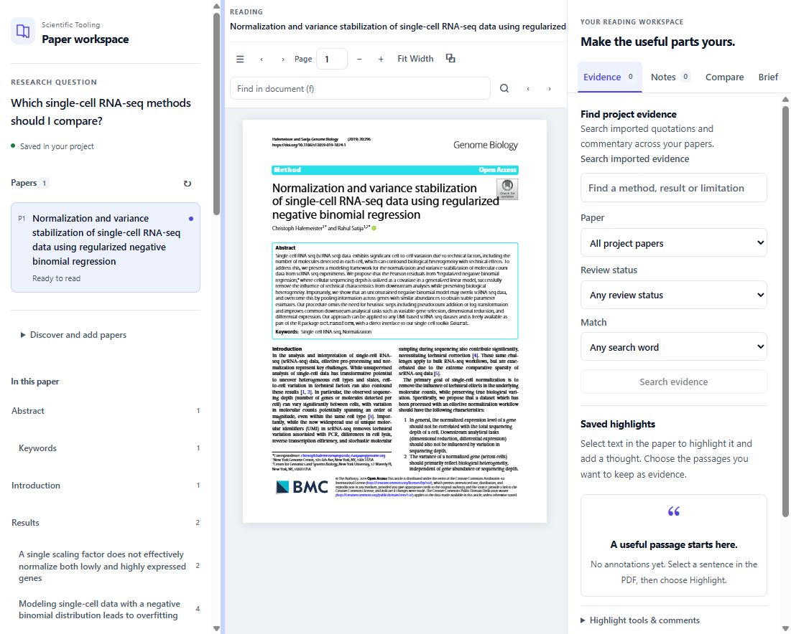
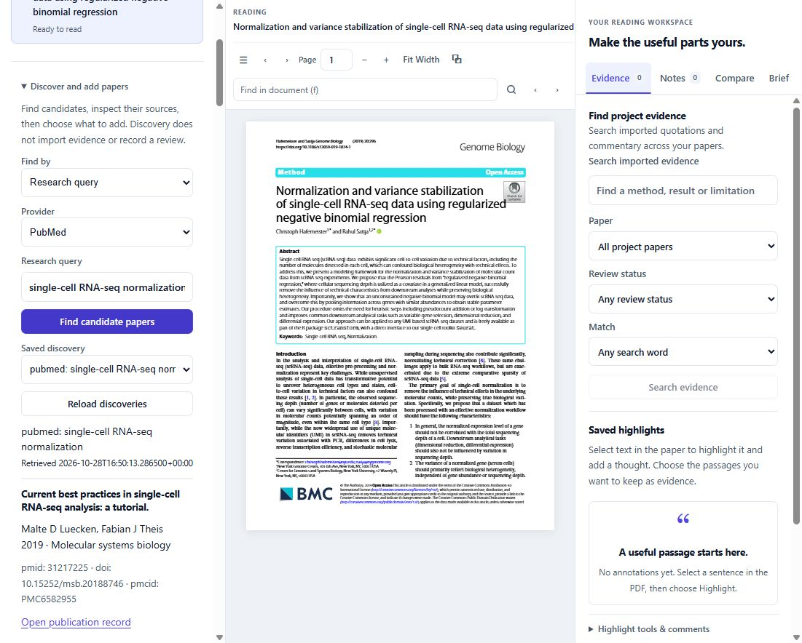
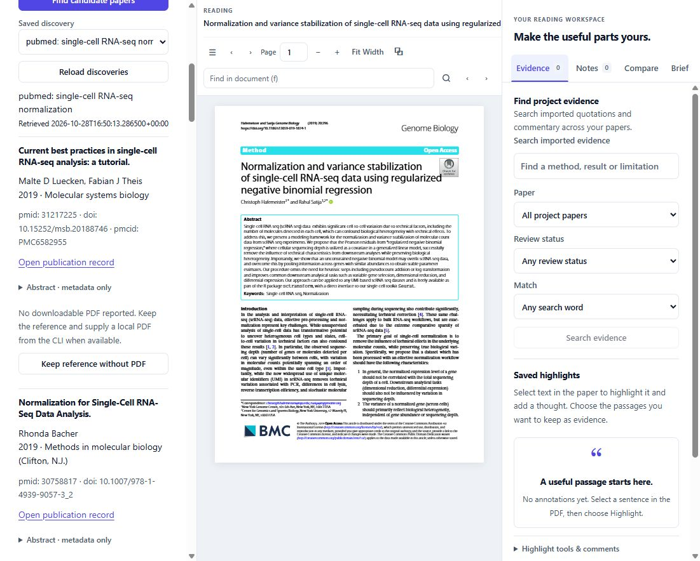
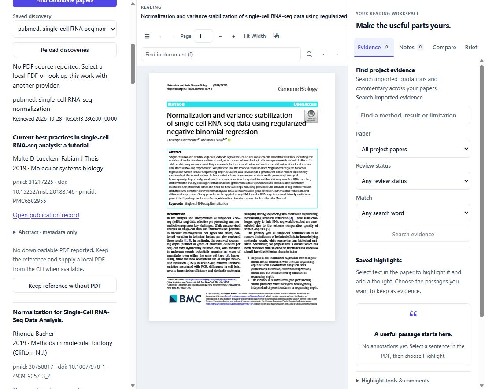
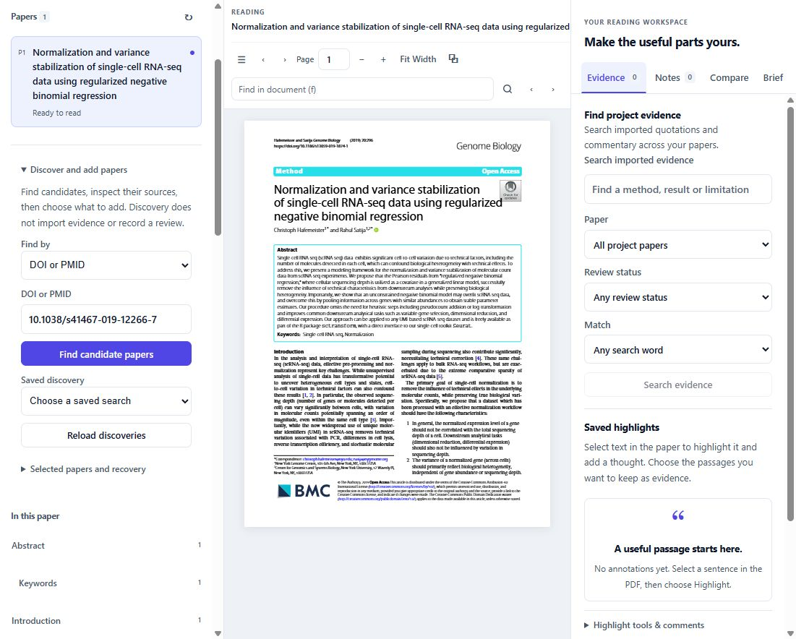
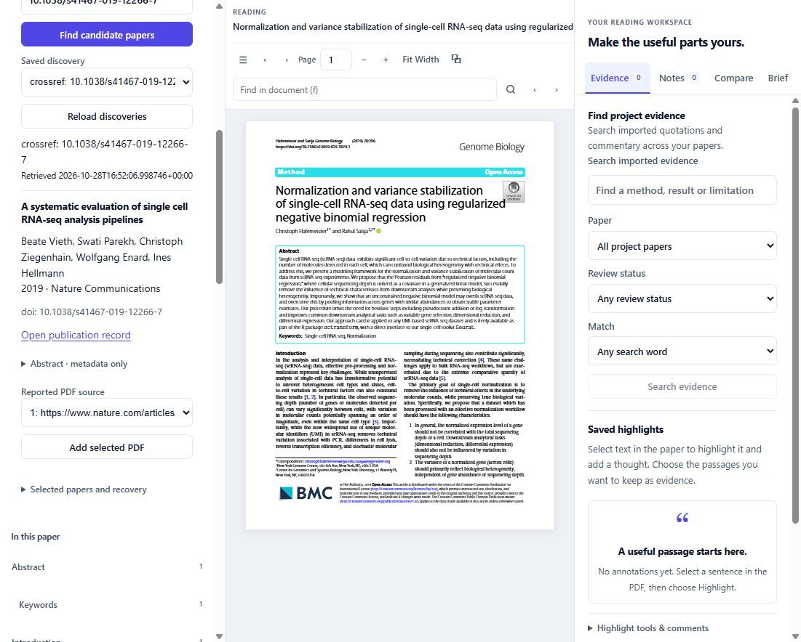
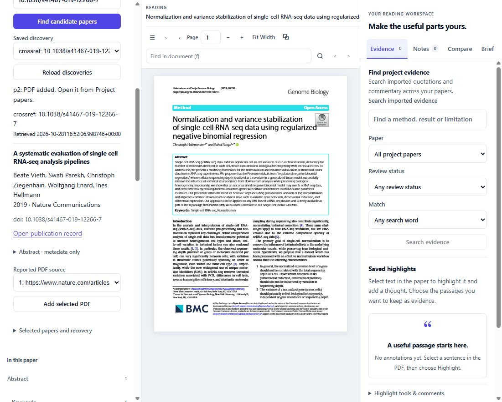
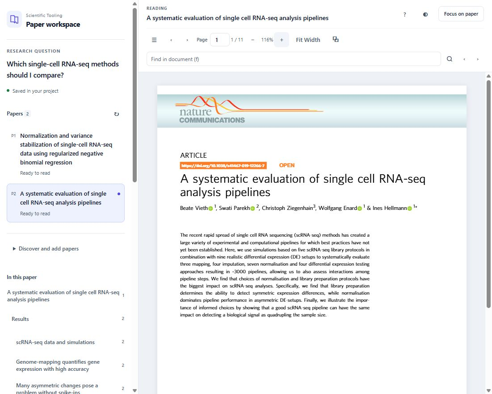
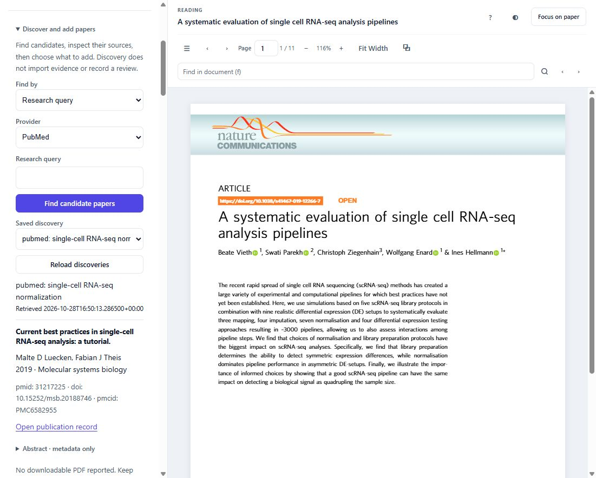

# Discover and add papers screenshot guide

Follow these nine screenshots to search for papers, inspect their sources, add a
selected PDF and open it in the reader. They show the discovery development build
with real PubMed/Crossref results, captured October 28, 2026.
The reader layout has since been refined; the discovery steps remain the same.

## Before you start

Open a project that already contains a PDF:

```text
sci resume --workspace my-review
```

Browser discovery requires the matching sci/APW development build described in
the [discovery guide](discovery.md). For a new question-only project, use the
[CLI setup and first selection](discovery.md#start-with-a-question) before opening
the reader. The screenshots begin with one existing paper and add a second.

In this local multi-repository checkout, you can reopen the example shown here
from the parent `github` directory using PowerShell:

```powershell
.\.discovery\installed\Scripts\sci.exe resume --workspace .\.discovery\walkthrough
```

## 1 Open paper discovery

In the left paper navigation panel, click **Discover and add papers** below the
paper list. If the panel is hidden, use the **Papers** menu button in the toolbar.



## 2 Search by research topic

Choose **Research query** under **Find by**. Select **PubMed** or **Crossref**, enter
a query, and click **Find candidate papers**. This example searches PubMed for
`single-cell RNA-seq normalization`. Results appear below the form; scroll inside
the left panel to inspect them.



## 3 Inspect candidate papers

Check the title, authors, year, venue and identifiers. **Open publication record**
opens the provider's record. Expand **Abstract · metadata only** to read an
abstract. The provider, query and retrieval date identify the saved search.



## 4 Keep a reference when no PDF is reported

Click **Keep reference without PDF** to retain a candidate's bibliographic
reference. The status explains that no PDF source was reported. You can later
look up its DOI through Crossref or select a local PDF using the CLI. The paper
list gains a reading entry once a PDF has been added.



## 5 Look up an exact DOI or PMID

Switch **Find by** to **DOI or PMID**. Enter the identifier, then click **Find
candidate papers**. DOI lookup uses Crossref; PMID lookup uses PubMed. Here the
example continues with `10.1038/s41467-019-12266-7`.



## 6 Choose the PDF to add

Inspect the returned paper and its **Reported PDF source**. Choose a source when
several are available, then click **Add selected PDF**. This example uses the
publisher PDF reported by Crossref. A reported link is checked when you add it;
publisher access or download failures are shown explicitly.



## 7 Wait for the addition to finish

Wait for **p2: PDF added. Open it from Project papers.** The workspace now retains
the selected PDF and its reading session. Paper keys depend on how many papers
were already in your project.



## 8 Open and read the selected paper

Scroll to the paper list and click the new paper, **p2** in this example. Its
original PDF opens in the center. Use the page, zoom and document-search controls
to read it. The right workspace panel is hidden in this screenshot to give the
PDF more room; its toolbar button reopens Evidence, Notes, Compare and Brief.



## 9 Reopen a saved search

Expand **Discover and add papers** and choose an entry from **Saved discovery**.
The original candidates and retrieval date reappear without another provider
search. **Selected papers and recovery** lists previous selections and offers
retry when an import was interrupted.



Adding a paper prepares it for reading. Evidence import and comparison review
remain separate, explicit steps.

## Article attribution

The example PDFs are Hafemeister and Satija, *Normalization and variance
stabilization of single-cell RNA-seq data using regularized negative binomial
regression* ([DOI](https://doi.org/10.1186/s13059-019-1874-1)), and Vieth et al.,
*A systematic evaluation of single cell RNA-seq analysis pipelines*
([DOI](https://doi.org/10.1038/s41467-019-12266-7)). Their article content is
licensed under [CC BY 4.0](https://creativecommons.org/licenses/by/4.0/).
Screenshots show portions of the PDFs rendered in the reader; article text was
not edited. Bibliographic results come from the displayed PubMed/Crossref records.
