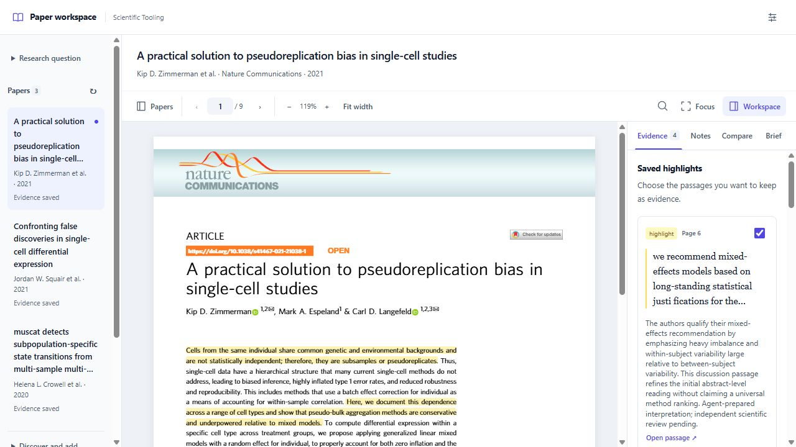

# sci CLI in two minutes

**`sci` is a local research project tool that connects papers, saved evidence,
comparisons and source-linked briefs.** CLI means *command-line interface*: you
type a short command to start or resume a project, then use the browser reader
to read papers and inspect evidence. An AI agent can use the same commands.

A project is a folder containing your question, retained PDFs, reading sessions,
selected evidence and saved outputs. You can return later without rebuilding the
reading set or losing the sources behind a finding.



*The current development reader: papers on the left, the original PDF in the
center, and Evidence, Notes, Compare and Brief on the right.*

## What you can do

| Task | What sci provides | Availability |
| --- | --- | --- |
| Read several papers together | One question, a paper list, highlights, notes and saved reading sessions | Released baseline |
| Keep selected evidence | Preview an import, retain quotations and commentary, and return to supporting passages | Released baseline |
| Produce a project brief | Download a brief with evidence coverage and source links; resume later | Released baseline |
| Find relevant saved evidence | Search imported quotations and commentary across your project | Development |
| Compare findings | Organize interpretations by paper and criterion, retain conditions, and record actual human reviews | Development |
| Discover papers | Search PubMed/Crossref or look up a DOI/PMID, then choose a PDF to add | Development |
| Maintain the project | Check what changed, keep earlier brief editions and explicitly repeat a search | Development |
| Prepare an analysis handoff | Save a draft with selected evidence, dataset identity, parameters and environment specification | Development draft feature |

Availability checked October 29, 2026. **Released baseline** means tagged sci
0.3.1; **Development** means later repository `main` functionality. The analysis
handoff is included in the `0.4.0.dev20261029` development build. It saves a draft;
analysis execution and scientific review remain separate. Run `sci --help` to see
the commands your installation has. Exact revisions and validation are retained
in the [development handoff](phase-2-handoff.md).

The [development feature completion plan](sci-roadmap.md#development-feature-completion-plan)
sets out the remaining work, acceptance criteria and release sequence for these features.

## Start with one paper

Use Python 3.12 or newer and Git; the repository recommends Python 3.14. Install
the current public source in your Python environment:

```text
python -m pip install --upgrade "git+https://github.com/Scientific-Tooling/structured-intelligence.git"
sci doctor
sci start "paper.pdf" --question "Which findings address my research question?" --workspace "my-review"
```

In the reader, highlight a passage, select it in **Evidence**, click **Preview
selected evidence**, then inspect and import it. Open **Brief** to download the
result or return to its source passages. Continue later with:

```text
sci resume --workspace "my-review"
```

## What requires your judgment

The CLI does not call a language model, automatically judge papers, or turn
agent interpretations into reviewed evidence. The analysis handoff does not run
statistics. A person or an agent supplies the reasoning; the project preserves
the material, decisions and recorded review state behind it.

Read the [detailed guide with screenshots](sci-user-guide.md) for installation,
the complete workflow, command examples and recovery. Screenshot sources and
article attribution are recorded [here](images/sci-guide/README.md).
