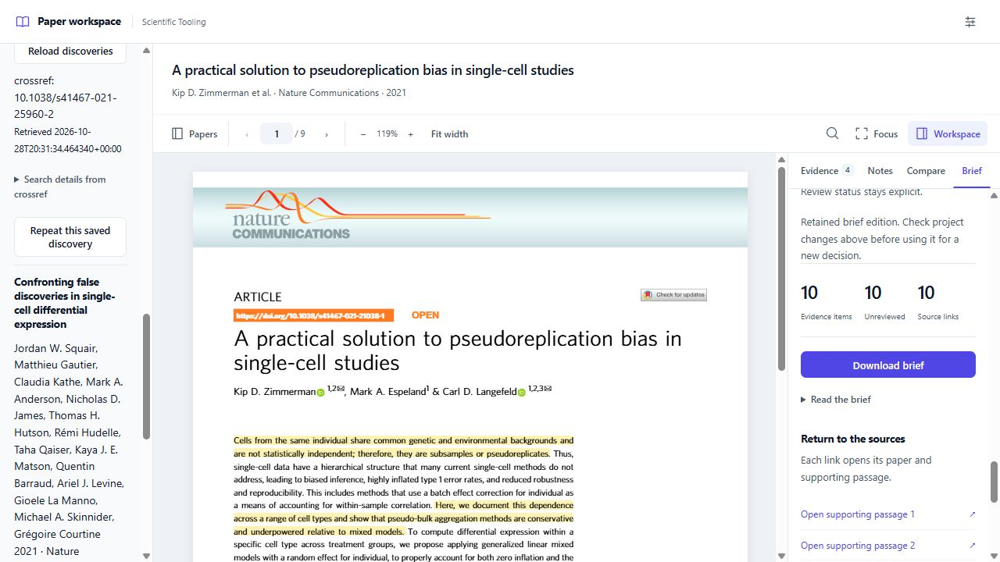
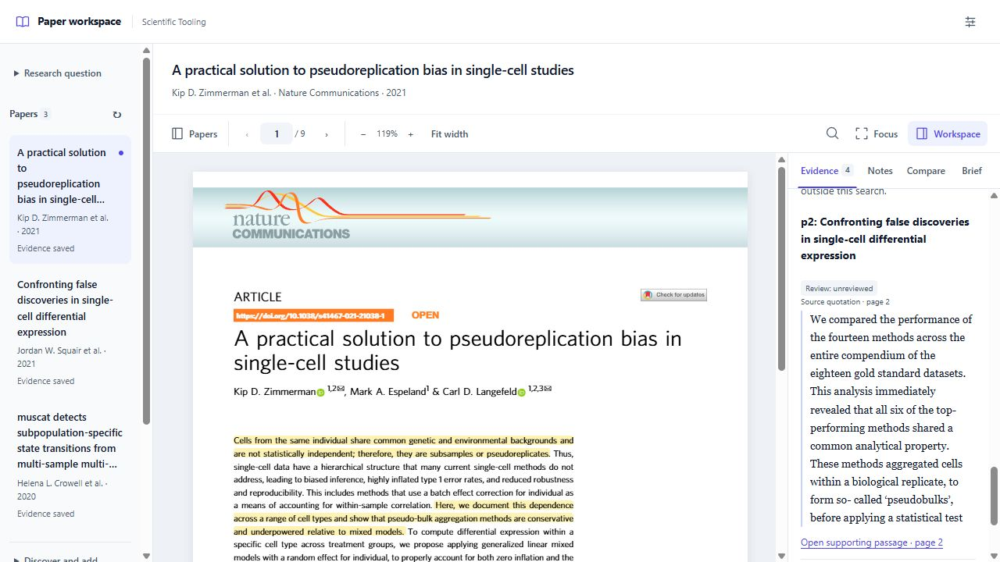
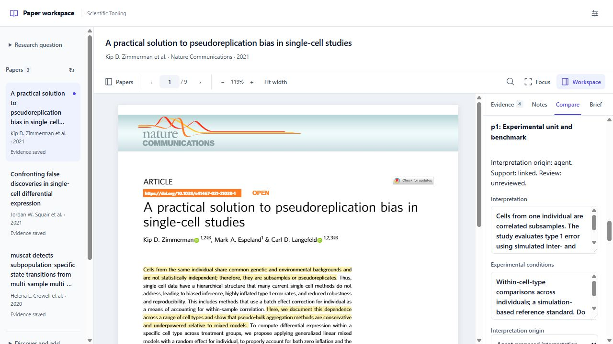
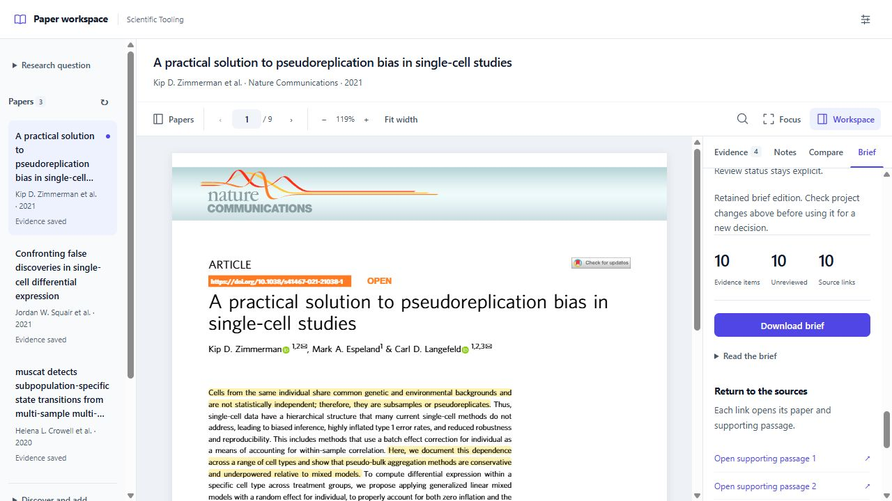
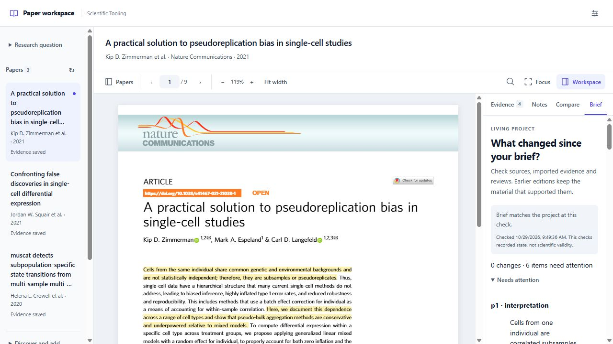

# sci CLI user guide

`sci` helps you carry a research question from papers to selected evidence,
comparisons and a brief whose sources you can inspect. Its command-line interface
starts and manages the project; its browser reader supports reading, highlighting
and reviewing. Both work with the same saved project, and an agent can use the
commands through structured JSON results.

For a short introduction, read [sci CLI in two minutes](sci-overview.md).

## Choose the capabilities you need

This guide describes the current workflow as of **October 29, 2026**. The
screenshots show the running development reader and an existing three-paper
project. They illustrate application behavior, not an endorsement of the displayed
scientific interpretations.

| Installation | Capabilities covered here |
| --- | --- |
| Tagged sci 0.3.1 | Multi-paper projects, reading, highlights, notes, explicit evidence import, source-linked briefs and resume |
| Public repository development build `0.4.0.dev20261029` | Project evidence search, comparisons and review, discovery, change checks, retained brief editions and draft evidence-to-analysis handoffs |

Use `sci --help` and `sci COMMAND --help` to check availability and options. A
development installation can still report version 0.3.1. The wider repository
contains additional analysis skills; their presence does not mean the CLI runs
every skill automatically.

## Install and check sci

Use Python 3.12 or newer, pip and Git. Python 3.14 is the repository's recommended
version for the core tools. In your chosen Python environment, install the public
development version:

```text
python -m pip install --upgrade "git+https://github.com/Scientific-Tooling/structured-intelligence.git"
sci doctor
sci --help
```

This installs the compatible evidence backend and browser reader. The local
workflow does not require Node.js or a model API key. If `sci` is not on your
shell's PATH, replace it with `python -m scientific_tooling` using the Python
environment where you installed it.

To use the current local analysis-handoff implementation, run `python -m pip
install .` from this repository checkout in a separate environment. Installing
from the public Git URL will only include changes already pushed there.

For platform-specific setup, see the [Windows walkthrough](../workflows/research/windows-quickstart.md)
or [Linux and macOS walkthrough](../workflows/research/unix-quickstart.md).

## Start or resume a project

Start a new project from PDFs you already have:

```text
sci start "paper-a.pdf" "paper-b.pdf" --question "Which method fits my experiment?" --workspace "my-review"
sci add "paper-c.pdf" --workspace "my-review"
sci papers --workspace "my-review"
```

`my-review` is your project folder. Choose one question per project and keep that
folder at its original location. `start` opens the browser reader. Paper keys such
as `p1` and `p2` come from `papers` and remain stable within the project.


*Select a paper on the left. Read its original PDF in the center. Work with its
highlights and notes on the right.*

Use the page and zoom controls while reading. **Focus** provides more reading
space; **Papers** and **Workspace** show or hide the side panels. A paper switch
keeps the workspace layout and restores that paper's reading position.

For an existing project, use:

```text
sci resume --workspace "my-review"
sci open p2 --workspace "my-review"
```

Replace `p2` with a key from your own project. `resume` preserves the saved papers,
reading sessions, previews and evidence.

## Discover and choose additional papers

**Requires the development build.** For a question with no papers yet:

```text
sci init --question "How should I compare replicated single-cell experiments?" --workspace "my-review"
sci discover search "single-cell pseudobulk" --provider pubmed --limit 10 --workspace "my-review"
sci discover list --workspace "my-review"
```

Use `init` only for a new question-only project. It does not open the reader;
selecting the first PDF prepares a paper that can be opened. An existing project
can use the discovery commands directly.

In the reader, expand **Discover and add papers** below the paper list. Choose
**Research query** with PubMed or Crossref, or **DOI or PMID** for an exact lookup.
Inspect each candidate's title, source, identifiers and PDF availability. PubMed's
**Search details** shows the provider's interpretation of your query.



*Saved discovery reopens a previous result. Repeat this saved discovery performs
a new retrieval; it does not automatically add its candidates.*

CLI equivalents for inspecting and selecting a result are:

```text
sci discover lookup "10.1038/s41467-021-25960-2" --workspace "my-review" --json
sci discover show DISCOVERY_ID --workspace "my-review" --json
sci discover select DISCOVERY_ID --candidate CANDIDATE_ID --source 1 --workspace "my-review"
```

Replace uppercase placeholders with IDs from your own output. Choose the PDF
source number shown for that candidate. When no PDF is reported, keep a reference
or explicitly supply a local PDF with `--pdf "paper.pdf"`. An abstract or saved
reference does not become a read PDF or imported evidence.

See the [discovery guide](discovery.md) for selection recovery and the
[nine-step screenshot walkthrough](discovery-screenshots.md) for a complete
search-and-add example. That older walkthrough identifies its capture date and
earlier layout.

## Save evidence deliberately

1. Read the relevant passage and highlight it. Add a comment when interpretation
   or experimental context matters. Use **Notes** for longer observations and
   link them to supporting highlights where appropriate.
2. In **Evidence**, select the passages you want to retain, then click **Preview
   selected evidence**. Inspect the quoted text, paper, page and proposed changes.
3. Click **Import evidence & create brief** when the preview matches your intent.
   Open **Brief** to inspect the saved result.

Highlights and notes are reading material until selected for import. Quotations
remain distinct from commentary. Imported material retains its recorded review
state; a successful import does not constitute scientific review.

Agents can perform the same explicit selection through the CLI:

```text
sci status --workspace "my-review" --paper p1 --json
sci preview --workspace "my-review" --paper p1 --annotation ANNOTATION_ID --json
sci apply PREVIEW_ID --workspace "my-review" --json
```

Use IDs returned by your project. For several papers, `preview` and `annotate`
need an explicit paper key. After editing a selected item, create a fresh preview
before applying it.

## Find saved evidence across papers

**Requires the development build.** Open **Evidence**, scroll to **Find project
evidence**, enter a term and inspect the results. Filters can limit the results
to a paper or review status. **Open supporting passage** returns to the source.



*The open PDF is p1; the search result comes from p2. The result keeps its own
paper attribution and review label.*

```text
sci search "replicate" --workspace "my-review"
sci search "replicate" --workspace "my-review" --paper p2 --review unreviewed --json
```

This searches **imported evidence**, including its commentary. It does not search
every word of every PDF or unimported highlights. Use **Find in document** in the
reader to search the open PDF. See [evidence search](evidence-search.md) for matching
rules and filters.

## Compare findings and record review

**Requires the development build.** Open **Compare**, then create a comparison
with a title and criteria such as assumptions, dataset, limitations or applicability.
Choose **Inspect / edit** on a paper's entry to write an interpretation, record
its conditions and select supporting imported evidence.



*Conditions and origin stay beside the interpretation. A link to evidence and
a human review are separate attributes.*

```text
sci compare create --title "Method comparison" --criterion "Assumptions" --criterion "Limitations" --workspace "my-review" --json
sci compare list --workspace "my-review" --json
sci compare show COMPARISON_ID --workspace "my-review"
```

The matrix retains gaps and unsupported drafts. Use the original passages to
check an entry before recording a decision under **Record human review**. A real
review records the person's identity, scope, decision and statement against the
saved revisions. An agent must not invent that review. Changes to an entry or its
support can make an earlier review stale.

Criteria and the paper set are fixed when the comparison is created. To use
different criteria or include later papers, create another comparison. Use
**Download comparison** for Markdown; see [comparison and review](comparisons.md)
for the full editing and recovery commands.

## Read and download the project brief

Open **Brief** to inspect evidence counts, review state and source links. Choose
**Read the brief** or **Download brief**. Each supporting link opens its retained
paper and passage while the reader is running.



*This example has ten retained evidence items, all unreviewed. The count is a
coverage summary, not a scientific confidence score.*

```text
sci brief --workspace "my-review"
```

The brief groups imported material and its provenance; it does not automatically
infer agreement between papers or generate a validated scientific conclusion.

## Check changes and keep earlier editions

**Requires the development build.** The top of **Brief** reports changes since
the retained edition. Use **Check changes** for a fresh check, **Save change
report** to retain it, and **Earlier brief editions** to inspect previous outputs.



*Zero changes means the recorded inputs still match. The six unreviewed
comparison entries still need attention.*

```text
sci changes --workspace "my-review"
sci update --workspace "my-review"
sci history --workspace "my-review"
sci history EDITION_ID --workspace "my-review" --json
```

Inspect changed sources or interpretations before using the brief for a new
decision. Saving a change report does not refresh the brief. Create a new brief
when appropriate; earlier editions retain their supporting material. Repeat a
saved discovery explicitly with `sci discover repeat DISCOVERY_ID --workspace
"my-review"`. Ordinary change checks do not perform external searches, and this
slice does not schedule recurring searches automatically.

See [living projects](living-projects.md) for freshness and interruption recovery.

## Prepare a draft analysis handoff

**Currently a local draft feature, available through the CLI.** There is no
analysis execution tab in the screenshots. Start from the
[handoff request template](../examples/analysis-handoff/request.example.json),
choose exact comparison cells and revisions, and specify the dataset, rationale,
parameters, assumptions, proposed environment, resources and expected outputs.

```text
sci analysis create request.json --workspace "my-review" --json
sci analysis list --workspace "my-review"
sci analysis show HANDOFF_ID --workspace "my-review"
sci analysis check HANDOFF_ID --workspace "my-review"
```

The saved handoff preserves selected support and input fingerprints. Its check
detects changes to those inputs; it does not validate the statistical design or
execute the analysis. The [demonstration](../evaluations/analysis-handoff-demo-2026-10-29/README.md)
uses 200 synthetic cells, 80 genes and eight synthetic samples. Read
[analysis handoffs](analysis-handoffs.md) for generation, recovery and remaining
execution work.

## Work with an agent and return later

Install the bundled workflow skill in your agent host's skills directory:

```text
sci skill --dest "~/.codex/skills"
```

Reload skills in the host and ask it to use `paper-to-brief` for your project.
The agent can help identify passages, draft interpretations and coordinate
commands. `sci` itself does not call a model; the agent host provides reasoning.
Use `--json` on workflow commands when structured results are useful.

```text
sci status --workspace "my-review"
sci stop --workspace "my-review"
sci resume --workspace "my-review"
```

`stop` shuts down this project's reader; it does not erase the project. Stop the
old reader before upgrading its installation, then resume the same workspace.
Back up the entire project folder with all writers stopped. Keep its original
absolute location when restoring, because retained paths and citation links use it.

## Common questions

| Situation | Next action |
| --- | --- |
| `sci` is not found | Activate its Python environment or use `python -m scientific_tooling`. |
| A command such as `analysis` is missing | Inspect `sci --help` and the availability table; install the intended development checkout if needed. |
| A question-only project has no reader | Select or add its first PDF, then open the project. |
| A search returns no evidence | Check whether the relevant highlights were imported and whether filters exclude them. Use document search for full PDF text. |
| A source link does not open | Resume the original workspace; inspect any missing source or changed-passage message. |
| An import reply was lost | Retry the same preview ID. If the material changed, inspect a fresh preview. |
| A retained brief is outdated | Inspect the change report and affected interpretations before making a new edition. |
| A result is marked unreviewed | Its recorded revision has not received the relevant review; saving or reopening it does not approve it. |

The [quick start](../workflows/research/quickstart.md) covers core operation and
recovery. The [roadmap](sci-roadmap.md) distinguishes implementation from release
and independent scientific evaluation. Screenshot provenance and article
attribution are in [the image notes](images/sci-guide/README.md).
